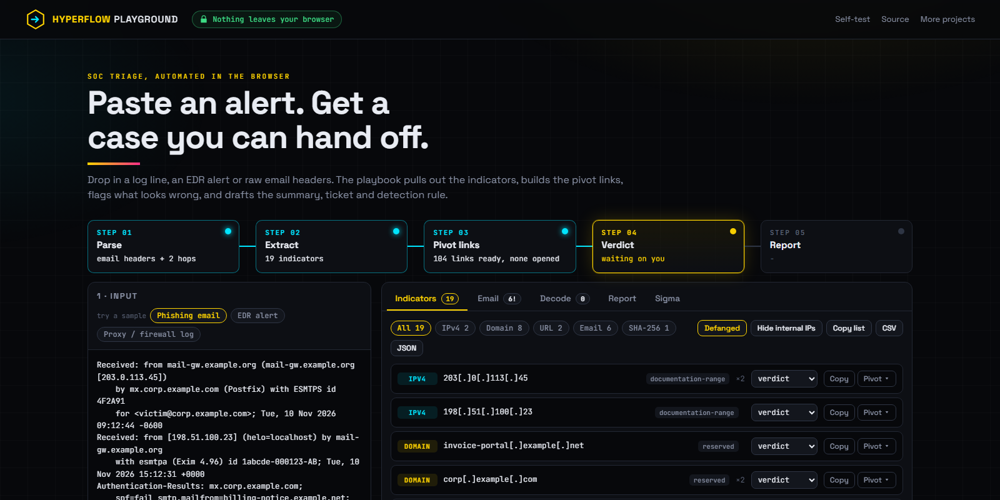
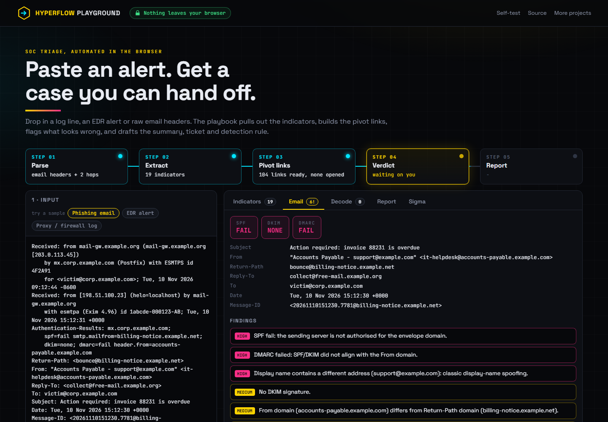

[](https://tootenramen.github.io/Hyperflow-Playground/)

# Hyperflow Playground

**Paste an alert. Get a case you can hand off. Nothing leaves your browser.**

A free security triage tool that runs entirely in the page. Paste a log line, an EDR alert or raw email headers and a
five-step playbook pulls out the indicators, builds the pivot links, flags what looks wrong, and drafts a triage
summary, an incident ticket and a Sigma rule. No install, no account, no backend.

**Live demo:** https://tootenramen.github.io/Hyperflow-Playground/



## What it does

| Step | What happens |
|---|---|
| **Parse** | Detects full email headers and reads SPF, DKIM, DMARC, the Received chain (with per-hop delay), and spoofing tells: From vs Return-Path, Reply-To mismatch, display-name tricks |
| **Extract** | IPv4 and IPv6, domains, URLs, emails, MD5 / SHA-1 / SHA-256, CVEs, Windows, UNC and Unix paths, registry keys. Deduped, counted, and restored from `hxxp`, `[.]`, `[at]` |
| **Pivot links** | Per-indicator lookups (VirusTotal, urlscan, AbuseIPDB, Shodan, GreyNoise, WHOIS, MXToolbox, crt.sh, NVD, CISA KEV and more). Built in the page, opened only when you click |
| **Verdict** | Mark each indicator benign, suspicious or malicious, set severity, add notes |
| **Report** | Triage summary, ticket draft, Markdown and JSON export, and a Sigma stub for hashes, network, DNS, proxy, registry and file activity |

Also built in:

- **Decoder:** base64, hex, URL, ROT13, PowerShell `-EncodedCommand` (UTF-16LE), refang and defang. Encoded payloads hiding in your input are found automatically and their indicators are added to the list.
- **Safe by default:** indicators are shown defanged, internal and RFC 1918 addresses are flagged so you do not paste them into public sites, and example or documentation values are marked reserved.
- **Flags that matter:** raw-IP URLs, credentials in URLs, shorteners, punycode look-alikes, abused TLDs, cleartext schemes, empty-file hashes.

## Nothing leaves your browser

The page ships a Content-Security-Policy with `connect-src 'none'`, so the browser itself blocks any network request
the code might try to make. There is no analytics, no storage and no account. Open DevTools, watch the Network tab,
and paste something. The only requests are the page files and the two Google Fonts stylesheets (no data from your
input). Lookup sites are links; they open only on a click and receive only the indicator you picked.

## What's inside

| Path | What it is |
|---|---|
| `index.html` | the playground: input, playbook strip, results tabs |
| `assets/ioc.js` | the engine: extraction, defang / refang, email headers, decoders, report, ticket and Sigma. Pure functions, no DOM, no network |
| `assets/app.js` | the UI that wires the engine to the page |
| `assets/samples.js` | three synthetic samples: phishing email, EDR alert, proxy log (RFC 5737 addresses, example domains) |
| `assets/style.css` | the look |
| `tests.html` + `assets/tests.js` | 130 real assertions: runs in the browser and under Node |
| `docs/` | screenshots |

## Use it

1. Open `index.html` in any browser, or visit the live demo. No install, no build step.
2. Click a sample, or paste your own text. It runs on paste; `Ctrl+Enter` runs it again.
3. Work through the tabs: **Indicators**, **Email**, **Decode**, **Report**, **Sigma**.

Deep links work for demos: `index.html#sample=edr&tab=report`.

## Run the tests

Open `tests.html`, or:

```
node assets/tests.js
```

## Limits worth knowing

- Extraction is pattern-based. It will miss exotic obfuscation and can occasionally flag a look-alike (a version string, a code identifier). Treat the list as a head start, not ground truth.
- Domains are matched against a TLD allow-list that deliberately leaves out ones that collide with file extensions (`.zip`, `.py`, `.sh`, `.md`, `.so`).
- The Sigma output is a stub. Check field names against your own log source before you deploy it.
- Pivot links go to third-party services. Do not click them for indicators you are not allowed to share.

---
Built by [Gustavo Freitas](https://github.com/Tootenramen) - [LinkedIn](https://www.linkedin.com/in/gustavo-freitas-69b93910b/) - [more projects](https://github.com/Tootenramen)
